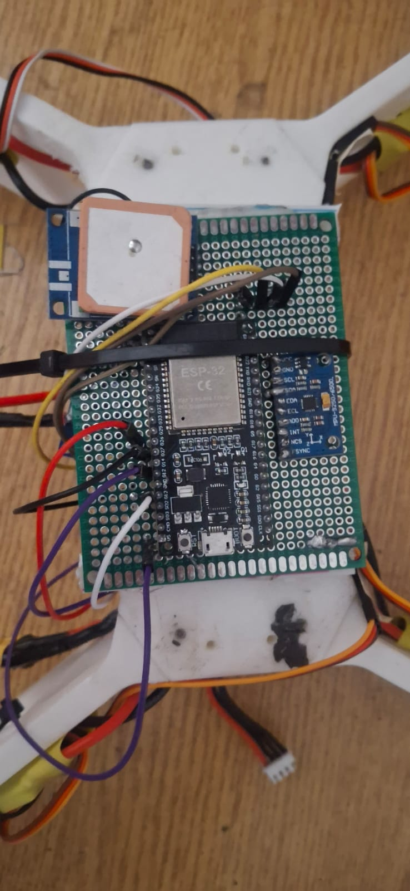

# DIY quadcopter flight controller: STM32 → ESP32

I wanted to understand what runs inside a flight controller, so instead of buying one I tried to build my own. First I tried on an STM32, then built a working one on an ESP32 with my own IMU filtering, cascaded PID, motor mixing, failsafe and two homemade controllers (a phone app, then a radio transmitter).



*ESP32 flight-controller board on the frame: ESP32 DevKit, MPU-9250 IMU, GPS module, ESC signal wires.*

<!-- Add the video of the flight controller here -->

> **Honest note:** the ESP32 flight code started from [pratikPhadte/ESP32-Flight-controller](https://github.com/pratikPhadte/ESP32-Flight-controller-) (angle mode) and was developed and rewritten with the help of an AI assistant. The hardware, wiring, calibration, testing and debugging were done by me. For the competition itself I later switched to an off-the-shelf **ArduCopter** flight controller. This repo documents the DIY version.

## The journey

| Stage | Hardware | What I did | Outcome |
|---|---|---|---|
| **1. STM32** | STM32F411CE Black Pill | Tried to port **INAV** → didn't work, so I started writing my own firmware in STM32CubeIDE (HAL): MPU-9250 over I2C, HC-SR04 with a hardware timer, GPS over UART, ESC PWM on TIM3, debug over USB | Sensors and ESC PWM working. The board **died**, which taught me why real flight controllers have power protection |
| **2. ESP32 + phone controller** | ESP32 DevKit | Angle-mode flight controller. The ESP32 hosts a WiFi access point, and a **phone web app** with two touch joysticks sends sticks over WebSocket | Sensors, controller link and motors working. PID tuning page |
| **3. ESP32 + DIY radio** | ESP32 + NRF24L01 ×2 | Built my own **radio transmitter** (2 joysticks + arm switch). Rewrote the flight code: dual-core, fixed 250 Hz loop, failsafe, arm/disarm state machine | Final DIY version (this folder) |

## How the flight controller works (`03-esp32-diy-radio/flight_controller.ino`)

```
Core 1 (250 Hz, fixed 4 ms loop)                         Core 0
 MPU-9250 ─► calibrate ─► low-pass ─► complementary ─┐    NRF24L01 receiver ─► sticks, arm, last-packet time
                                       filter       │    WiFi page ─► PID gains saved to flash
 sticks ─► angle PID (outer) ─► rate PID (inner) ◄──┘
        ─► X-frame motor mixing ─► 4 ESCs (500 Hz)
```

- **Calibration at boot:** 500 gyro samples for bias, 100 accelerometer samples for the level offset.
- **Filtering:** a first-order low-pass on the gyro (α = 0.7), then a **complementary filter** (0.991 gyro integration + 0.009 accelerometer angle). The gyro is accurate short-term but drifts; the accelerometer is noisy but doesn't drift.
- **Control:** a **cascaded PID**. The outer angle loop turns stick angle into a desired rotation rate, and the inner rate loop turns that into a motor correction. Both use **integral clamping (anti-windup)** and output limits. There is also an acro (rate-only) mode.
- **Mixing:** standard X-frame throttle ± roll ± pitch ± yaw, with an offset for one ESC that started spinning later than the others.
- **Safety:** arming only with low throttle, **failsafe** that cuts the motors if no radio packet arrives for 500 ms, and an idle state that resets the PID so the integral doesn't build up on the ground.
- **Dual core:** the radio and WiFi run on core 0 so they can never delay the flight loop on core 1. Shared values are protected with a critical section.
- **Live PID tuning:** connect to the `DRONE_FC` WiFi and open `192.168.4.1`. Gains are saved to flash and applied without rebooting.

## Wiring

### Stage 1: STM32F411CE
| Device | STM32 pins |
|---|---|
| MPU-9250 (I2C1) | SCL PB6, SDA PB7 |
| HC-SR04 | TRIG PA0, ECHO PA1 (TIM2), **through a voltage divider** (5 V echo, 3.3 V MCU) |
| GPS Neo-8 (USART2) | PA2 / PA3 |
| ESP32-CAM "marker found" signal | PB14 |
| ESC 1–4 (TIM3 PWM) | PB0, PB1, PA6, PA7 |
| Debug | USB CDC, USART1 PA9/PA10 |

### Stage 2: ESP32 + phone controller
| Device | ESP32 pins |
|---|---|
| MPU-9250 | SDA 21, SCL 22, AD0 → GND |
| HC-SR04 | TRIG 5, ECHO 18 (through a 1.2 kΩ / 1.2 kΩ divider) |
| GPS Neo-8 | TX → 16, RX → 17 |
| ESP32-CAM signal | GPIO12 → 34 |
| ESC signals | 13, 12, 14, 27, common GND |
| Power | 5 V from the ESC's BEC → VIN (only when USB is unplugged) |

### Stage 3: ESP32 + DIY radio
**Drone (receiver)**
| Device | ESP32 pins |
|---|---|
| MPU-9250 | SDA 21, SCL 22 |
| NRF24L01 (external antenna) | CE 4, CSN 5, SCK 18, MISO 19, MOSI 23, VCC 3.3 V |
| ESCs | M1 27 (front right), M2 13 (rear right), M3 26 (rear left), M4 12 (front left) |
| BMP280 (optional) | second I2C bus: SDA 32, SCL 33 |
| Power | 100 µF capacitor between 5 V and GND |

**Transmitter (`radio_transmitter.ino`)**
| Device | ESP32 pins |
|---|---|
| NRF24L01 (PCB antenna) | CE 4, CSN 5, SCK 18, MISO 19, MOSI 23, VCC 3.3 V |
| Left joystick (throttle / yaw) | VRX 34, VRY 35, SW 32, **VCC 5 V** |
| Right joystick (roll / pitch) | VRX 25, VRY 26, SW 33, **VCC 5 V** |
| Arm switch | 27 |

Packet: `{roll, pitch, throttle, yaw, armed}` at 50 Hz, 250 kbps. Throttle is forced to 1000 µs while disarmed.

## Problems I hit (and fixes)
- **INAV on the Black Pill didn't work** → wrote my own firmware with STM32 HAL instead.
- **ESC only beeped and wouldn't arm on the STM32** → debugged the timer clock and prescaler math for 1 µs ticks, and the ESC arming/calibration sequence.
- **The HC-SR04 outputs 5 V and the MCUs are 3.3 V** → added a voltage divider on ECHO.
- **MPU and BMP280 stopped reading on a shared I2C bus** → moved the BMP280 to the second I2C bus.
- **Motors started spinning at different throttle values** → ESC calibration, plus a per-motor offset for the odd ESC.
- **Boards died** (the STM32, and later an ESP32) → most likely voltage spikes from the ESC/power side. Fixed with a common ground, a capacitor on the 5 V line, and never powering the BEC and USB at the same time.
- **Joysticks read 0 on 3.3 V** → the modules needed 5 V (the outputs are still safe for the ESP32 ADC).
- **Safe PID tuning** → props off and tilting by hand first, then tied down with strings, then hover. Gains were tuned live from the web page.

## Files
```
01-stm32-black-pill/sensor_and_esc_tests.c        STM32 HAL bring-up: IMU, ultrasonic, USB debug, ESC PWM
02-esp32-phone-controller/controller.html         phone controller web app (touch joysticks, arm, mission buttons)
02-esp32-phone-controller/websocket_receiver_snippet.ino   drone side of the WebSocket link
03-esp32-diy-radio/flight_controller.ino          final DIY flight controller (dual core, PID, failsafe)
03-esp32-diy-radio/radio_transmitter.ino          DIY radio transmitter
```
